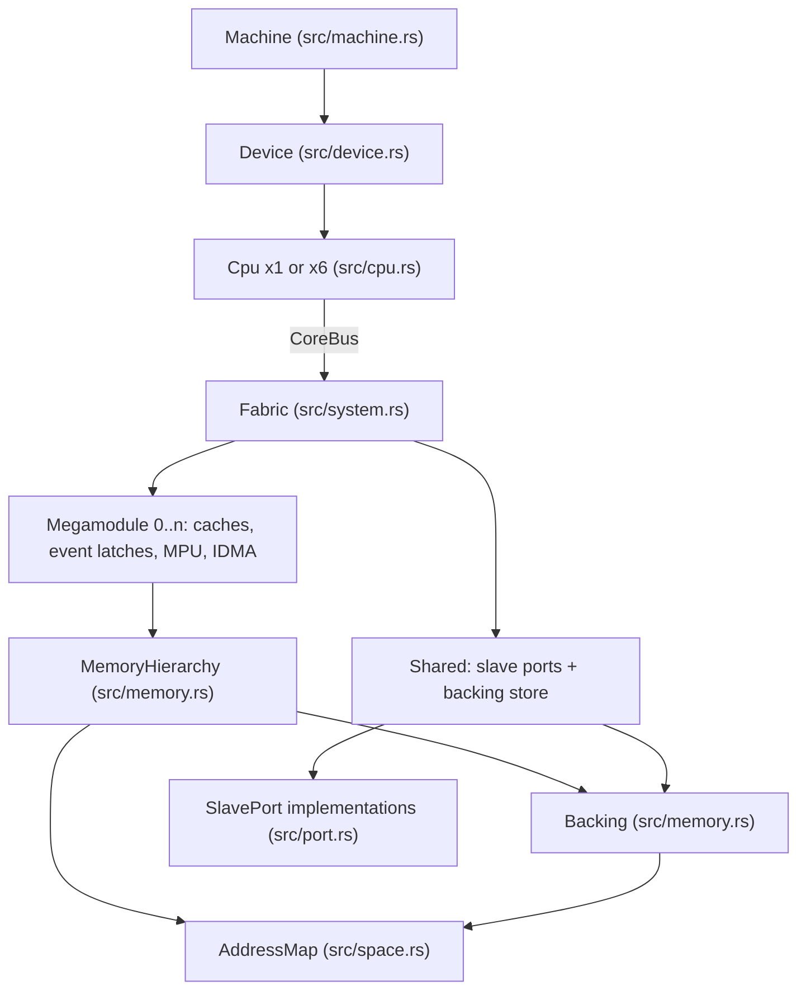

# Architecture

This document covers the seams the emulator is built from - machine, device, fabric, megamodule,
core bus, memory hierarchy, backing store, slave port - and the top-level execution model that
drives them: the tick model, the run loop, the halt rule and its stop conditions, the state
snapshot, and which file owns what. Every other document under `internals/` may assume it.

## What the emulator is, and what cycle-stepped means here

`c64xemu` is a Rust binary with three subcommands (`src/main.rs`): `decode` renders instruction
words with no image loaded, `run` executes a TI C6000 EABI ELF image in batch, and `debug` opens
the same image under one of three front ends. It models two devices of the C64x+ family, the
single-core TMS320C6455 and the six-core TMS320C6472.

Cycle-stepped means the unit of progress is one CPU cycle, not one instruction and not one
basic block. `Cpu::step` in `src/cpu.rs` is that unit: it fetches an execute packet, issues it,
schedules the register writes into the write-back queue, and ends the cycle. A cycle the
pipeline cannot use is still a cycle - `Cpu::step` returns early through `freeze` for a memory
stall, or through `commit_writes` and `finish_cycle` for a multicycle NOP, an interrupt
pipe-down or `IDLE`. Every one of those paths calls `Cpu::tick_device`, which is what keeps the
peripherals on the same time base as the pipeline: exactly one device tick per step of the core,
stalls included. `Cpu::cycles()` reports `cycle + stalls`, so it counts steps, and the
`device_ticks` counter a core asks the fabric with counts the same steps.

What a cycle does *inside* itself - delay slots as the write-back queue, packet validity, branch
resolution, the SPLOOP buffer - belongs to [Execution and timing](execution.md).

## The layers, and the seam each one presents

| Layer | Type | File | Seam it presents |
|---|---|---|---|
| machine | `Machine`, `MachineArgs` | `src/machine.rs` | `load`, `arm_halt`, `run`/`resume(&mut [StopCondition])`, `snapshot`, `state_json` |
| device | `Device`, `DeviceProfile` | `src/device.rs` | `run_cycles`, `step_cycle`, `halted_core`, `focus`/`set_focus`, `with_core`, `fabric` |
| fabric | `Fabric`, `Megamodule`, `Shared` | `src/system.rs` | `read32`/`write32` per requesting core, `tick(cycle)`, `raise(destination, event)` |
| core bus | `CoreBus<'a>` | `src/system.rs` | everything one core may ask of the device, with its core index already bound |
| memory hierarchy | `MemoryHierarchy`, `BoundHierarchy` | `src/memory.rs` | `read_u32`, `fetch_packet`, `snoop_read`, `host_snoop_read`, `access_timing` |
| backing store | `Backing` | `src/memory.rs` | `placement`, `read_bytes`, `write_bytes` by `Requester` |
| address map | `AddressMap`, `Placement`, `Requester` | `src/space.rs` | which physical memory a requester's address lands in |
| slave port | `SlavePort`, `PortContext`, `PortWrite` | `src/port.rs` | `read(address, context) -> Option<u32>`, `write(...) -> PortWrite` |



A megamodule holds one core's private half of the device: its memory hierarchy, its four banks
of event flags, lines and masks, the exception combiner masks, the interrupt selector registers,
the bandwidth manager registers, the three memory protection units with their page attributes
and fault registers, the L2 power-down state, its IDMA, and whether the boot controller is
holding this core in reset (`Megamodule` in `src/system.rs`). It holds no bytes: the storage
behind the caches is the backing store, which `Fabric::memory` binds in on every access with
`MemoryHierarchy::bind`.

### Lending the fabric

There is one `Fabric`, in a `Box`, and exactly one holder at a time. At rest that is the focused
core - `Cpu::attach` and `Cpu::detach` move it, and `Device` tracks only `focus` - so
`device.cpu()` behaves the way a single-core `Cpu` always did. While the device runs cycles it
detaches the fabric and holds it itself for the whole batch, handing each core it runs a bus
onto it through `Cpu::step_on`; it gives the fabric back to the focused core before returning,
so no caller ever sees it anywhere else. That is why a core reaches the shared peripherals
without holding a reference to any other core, and why `CoreBus` is just `{ core, fabric }` -
the core index is the only thing the CPU adds to the seam. `Device::with_core` lends the fabric
to a named core for one closure and gives it back; `Device::fabric()` reaches the device-level
operations no single core owns.

The focused core is what every front end drives: `Machine::pc`, `snapshot`, `read_memory`,
`set_register` and `cache_views` all go through `Device::cpu`/`cpu_mut`, and `set_focus` moves
the fabric so the newly focused core is inspected and driven exactly like the old one.

## How a device cycle advances

`Device::cycle_on` is one device cycle, and the only implementation of one: `Device::step_cycle`
runs a single cycle through it and `Device::run_cycles` runs a batch of them. It walks cores in
index order, skips any core that `Fabric::held_in_reset` or `!Fabric::core_clocked` (the C6472's
power/sleep controller can gate a megamodule's clock) - asked when that core's turn comes, so an
earlier core's access can hold, release or gate a later one in the same cycle - and steps each
core it does run with `Cpu::step_on` against the fabric the device is holding. After the cores,
it calls `fabric.tick(self.cycle)` - with every core held in reset the peripherals still run,
which is how a host boots the device through the HPI while the cores wait - then advances the
ROM boot if one is strapped, then applies the device-level effects of the cycle in
`apply_device_requests`: cores the boot controller or the power/sleep controller released (set
to their `boot_address` and let out of reset) and cores whose NMI pin the chip-level registers
drove.

`Fabric::tick(cycle)` is guarded, and the guard is the whole tick model:

- The first ask of a cycle is the one that runs. A later ask with `cycle <= ticked_cycle`
  returns the answer the first ask produced.
- Each core asks once per step of its own, from `Cpu::finish_cycle` or `Cpu::freeze`, with its
  own `device_ticks` counter. A core that stalls therefore drifts behind the others and simply
  skips its ask until it catches up, so the peripherals advance at the rate of the fastest core
  rather than six times per cycle.
- `SYSCLK3_DIVIDER` is 6: one tick in six is a SYSCLK3 edge, and `Fabric::tick_device` gates
  the timers, the GPIO pins, the UTOPIA port and the C6455's device configuration block on it.
  The IDMA, the MACs, the EDMA3, the I2C, the McBSPs and the MDIO are considered on every full
  device cycle, but only while their bit in the activity summary is set: a peripheral whose bit
  is clear was inactive and only a register write can arm it.
- A tick that is neither a SYSCLK3 edge nor dirty returns `true`, the *short* tick: nothing
  cycle-driven moved, and the asking core reads the interrupt lines the last full tick
  selected rather than fresh ones. `Cpu::finish_cycle` passes that flag straight into
  `CoreBus::take_interrupt_state`. A dormant device answers "nothing asserted" for millions of
  cycles, which is what the short path exists for.

`Machine::resume_budget` asks the device for a batch with `Device::run_cycles(batch, cio,
ignore_cio_once)` whatever the core count, and the device picks how to run it. With one core
and no ROM boot in progress, `Device::step_cycle` is bypassed entirely on the fast path:
`Cpu::run_cycles` steps the CPU (which ticks the device from inside) until a halt address, the
CIO boundary or the batch bound, and answers in core cycles without moving `Device::cycle`.
With six cores, or during a ROM boot - the boot is device state and the core it is booting is
held - the device runs whole device cycles through `cycle_on`, checking before each one that no
core out of reset has halted and that no core is ready to fetch the CIO breakpoint (except on
the first cycle of a batch that has just answered the handshake), and answers in device cycles.
Those two tests do not rescan the cores: a private `Boundaries` keeps each as a bit mask per
core, observed again after the core steps and after the device moves its PC (the ROM boot's
entry, a boot-controller release). Both predicates read only a core's own state, which nothing
else changes inside a batch, so the masks always equal a fresh scan. Held-in-reset is fabric
state and is read at the moment of the test, as the halt rule requires.

Cores in the same cycle run in index order, and the ones that follow see the peripheral state
the first core has already produced. Six cores are concurrent on silicon; this ordering is a
choice the hardware does not make, taken because it is deterministic, which is worth more to a
debugger than an invented interleaving. Boot mode 0 releases all six at once, so they advance in
lockstep:

```
$ ./target/release/c64xemu run tests/firmware/bios_kernel/build/bios_kernel.out \
    --device c6472 --max-cycles 2000 --state-out /tmp/c6472.json
c64xemu: cycle limit 2000 reached at PC 0x00812e98
$ jq -c '.cores[] | {core, pc, cycles, held_in_reset}' /tmp/c6472.json
{"core":0,"pc":8466072,"cycles":2000,"held_in_reset":false}
{"core":1,"pc":8466072,"cycles":2000,"held_in_reset":false}
...
```

In a ROM boot mode only core 0 runs, and the others sit at their reset PC with no cycles on
them until something releases them - see [The six-core device](../guide/multicore.md):

```
$ ./target/release/c64xemu run tests/firmware/bios_kernel/build/bios_kernel.out \
    --device c6472 --boot-mode 2 --max-cycles 2000 --state-out /tmp/c6472b.json
c64xemu: cycle limit 2000 reached at PC 0x00812e98
$ jq -c '.cores[] | {core, pc, cycles, held_in_reset}' /tmp/c6472b.json
{"core":0,"pc":8466072,"cycles":2000,"held_in_reset":false}
{"core":1,"pc":8462656,"cycles":0,"held_in_reset":true}
{"core":2,"pc":8462656,"cycles":0,"held_in_reset":true}
...
```

## How an access is routed

Every CPU access enters `Fabric::read32`/`write32` with the requesting core's index. The first
question is `directly_routed_memory`: an address outside `0x0180_0000..0xa000_0000` is memory
and nothing else, so it goes straight to `Fabric::memory(core)` - the megamodule's hierarchy
bound to the backing store - with no port walk at all. That is the common case, and it is why
the router costs nothing on a load from L2 or DDR2.

Inside that band the order is fixed:

1. `Shared::touched` marks the device dirty, so the next tick re-derives the activity summary
   and the level-triggered interrupt sources instead of trusting its cache.
2. `Fabric::peripheral_read`/`peripheral_write` walks `Shared::ports`, one list built once from
   the device profile by `Shared::port_order`. Declaration order in the `Port` enum is consult
   order and is load-bearing: the C6472's chip-level registers claim a whole window, so they
   answer after every port whose registers sit inside it. The one address the router decodes
   itself is `MACINVECTOR` (`Fabric::mac_input_vector`), because it sits in the EMAC's register
   map but reports the MDIO's interrupts too.
3. A port that answered leaves a follow-up, named by `Port::after_read`/`after_write` and
   performed by `Fabric::follow`: latch the EMAC, EDMA3, I2C or UTOPIA interrupt, latch transfer
   controller errors, release booted cores, apply power transitions, consume a prefetch flush,
   or deliver inter-processor interrupts. The interrupt latchers stay in the router because a
   follow-up the megamodules are owed is not part of a port's shape.
4. `Megamodule::cfg_read`/`cfg_write` answers the megamodule's own `0x0180_0000` configuration
   space - event flags and masks, INTMUX, the bandwidth manager, MPU pages, `MM_REVID`, L2
   power-down, IDMA. A write may come back as `CfgWrite::Event`, which the router raises in that
   megamodule (this is IDMA's completion event).
5. Anything still unclaimed falls through to memory.

`PortContext` carries what a port needs but does not own - today only the device's endianness,
because three ports report their registers byte-swapped when the device is strapped big-endian
and it is settable at runtime, so a port cannot cache it. `PortWrite` reports `Unhandled`,
`Done` or `Event(usize)`.

Given an address and a requester, this is which module answers:

| Access | Path |
|---|---|
| Program fetch | `CoreBus::fetch_packet` → `BoundHierarchy::fetch_packet` (L1P) → `Backing` |
| CPU load or store outside `0x0180_0000..0xa000_0000` | `Fabric::memory(core)` → L1D, L2, `Backing` |
| CPU access inside that band | port walk → `Megamodule::cfg_*` → memory, as above |
| CPU access to a restricted page | `Fabric::check_access` first; a violation latches MPFAR/MPFSR and raises the unit's event |
| DMA master to memory (`is_memory`) | `Fabric::dma_read32`/`dma_write32` → `dma_bytes`/`dma_store`, with the L2 snoop |
| DMA master to a register aperture | `Fabric::dma_register_read`/`dma_register_write` → `read32`/`write32` as the reset core |
| HPI host side | `Fabric::hpi_host_read`/`hpi_host_write` through `lend_hpi`, then the same paths as any other master |
| Debugger or front-end read | `Fabric::host_read_bytes` - backing plus `host_snoop_read`, disturbing no cache state |

A master that moves data - either MAC, the EDMA3, the HPI host side - is moved out of its slot
for the duration of its own transfer (`lend_emac`, `lend_edma`, `lend_hpi`), because the
callback needs `&mut Fabric` to reach memory *and* registers. The consequence worth knowing is
that the slot is empty while the callback runs, so a master is not addressable by its own
transfer: an access to its own register block finds no port and falls through to memory behind
the aperture.

### Where snooping enters

Coherence is applied by the fabric on the megamodule that owns the memory, and only there.
`Fabric::snooped_l2` resolves a DMA address through the backing store and answers only for
`Placement::CoreL2`; `dma_bytes` then calls `MemoryHierarchy::snoop_read` and `dma_store` calls
`snoop_write` on that megamodule. So L2 SRAM is snooped against L1D, external memory is not
snooped at all, and memory a core has converted into cache is not L2 SRAM and is not snooped
either. On a multicore device the line may be tagged with the local or the global address
depending on which the core used, so both are looked for. `host_read_bytes` and
`host_write_bytes` do the same for the debug port, including on another core's memory.
[Memory and caches](memory-and-caches.md) owns the protocol itself.

## The device profile

`DeviceProfile` in `src/device.rs` is the single place device differences live: every difference
is a field of it rather than a branch in the model. `DeviceProfile::named` maps the `--device`
value to one of the two constants.

| Field | What it decides |
|---|---|
| `name` | The device string in the state snapshot |
| `map` | The address map: local windows, global aliases, shared memories, DDR2 window, and `cores` |
| `events` | The device event map: source to system event, destination and EDMA3 channel |
| `emac_bases`, `emic_bases` | How many MACs there are, and whether each has an interrupt-control module |
| `timer_bases` | The 64-bit timers, in device order |
| `mpu_regions` | Memory protection page geometry of one megamodule: unit, base, page size, MPPA index range |
| `has_mcbsp`, `has_utopia`, `has_emifa`, `has_device_config` | Peripherals a device either has or does not |
| `has_boot_controller` | The C6472 block set: boot controller, chip-level registers, power/sleep controller, shared-memory controller and its per-core profilers |
| `reset_core` | Which core runs at reset with no boot controller involved |
| `jtag_id`, `megamodule_revision`, `mdio_version` | The identification registers |

| | C6455 | C6472 |
|---|---|---|
| Cores (megamodules) | 1 | 6 |
| Local L2 SRAM | 2 MB | 608 KB each |
| Shared memory | none | 768 KB L2 RAM, 768 KB L2 ROM |
| Global aliases | none | one block per core, every 16 MB from `0x1000_0000` |
| Ethernet | one MAC at `0x02c8_0000`, no EMIC | two MACs at `0x02c8_0000`/`0x02cc_0000`, an EMIC each |
| Timers | 2 | 12 (six per-megamodule, six shared) |
| MPU geometry | L2 32 x 64 KB, each L1 32 x 1 KB | L2 19 x 32 KB plus 12 x 64 KB shared, each L1 16 x 2 KB |
| McBSP / UTOPIA / EMIFA / device configuration | yes / yes / yes / yes | no / yes / no / no |
| Boot controller block set | absent | present |
| `jtag_id` | `0x0009_202f` | `0x0009_102f` |
| `megamodule_revision` | `0x0001_0000` | `0x0001_0003` |
| `mdio_version` | `0x0007_0102` | `0x0007_0103` |

The geometry above is documented at [SPRS276M](../reference/sprs276m.pdf) section 2.3 and
Table 2-2 for the C6455, and
[SPRS612G](../reference/sprs612g.pdf) sections 2.3, 2.4, 5.1 and 5.2 for the C6472; the page
geometry follows [SPRU871K](../reference/spru871k.pdf) chapter 8. Which peripherals then exist
is `Shared::port_order` reading those flags, and nothing else in the model asks which device it
is running on.

## The halt rule and the stop conditions

`Machine::arm_halt(breakpoints)` retains the driver's addresses and combines them with the
program's exit point (`--stop-pc`, else `C$$EXIT`, else abort) into every core's fetch-halt set.
The driver updates that list only at startup or when its breakpoints change; reload restores
it and changing focus does not alter it.

`Machine::run` respects a breakpoint at the current address, including the image's entry point.
`Machine::resume` is the interactive continue/step operation: it excludes each core's current
address for that call, then restores the full halt set before returning, including on host-I/O
errors. The exclusion is per core, so moving one core off an address does not disable a halt
at that address for another core. Drivers keep their own lists for labels and editing, but
never manage exclusion or post-stop rearming.

`StopReason::Breakpoint(BreakpointHit { core, address })` identifies the halt rather than asking
each caller to infer it from the focused PC. Held cores are ignored; simultaneous hits choose
the lowest core index. Reporting or inspecting the hit never changes focus. The console and
dashboard name the stopped core and address, and GDB returns the stopped thread plus its PC
in the stop reply while keeping subsequent register reads on the selected core.

The CPU enforces it at the fetch boundary: `Cpu::stops_at` is checked with a clean pipeline, and
when it fires the cycle is counted as a halt cycle and nothing is fetched. That path does not
tick the device from the core, so on the single-core fast path `Cpu::run_cycles` breaks out of
its batch; under `Device::cycle_on` the device-level `fabric.tick(self.cycle)` still runs, so
the peripherals keep advancing while a core sits halted. What the halt leaves observable is
`Cpu::halted()` and `Cpu::ready_to_fetch_at(address)`. The two differ deliberately:
`ready_to_fetch_at` additionally requires the SPLOOP buffer to be empty, because a breakpoint
inside a software-pipelined loop legitimately halts mid-buffer.

Both execution operations use the same stop-condition loop, evaluated once per cycle before
the cycle runs, so a driver check doubles as a per-cycle hook. The machine-native conditions
are always members and are checked first, in this order:

| Order | Condition | `StopReason` |
|---|---|---|
| 1 | `Cpu::fault()` is set on the focused core | `Fault` |
| 2 | `Machine::at_stop` - any core out of reset is about to fetch the exit point | `Exit` |
| 3 | `Machine::halt_location` - any core out of reset stopped on an armed address | `Breakpoint(hit)` |
| 4 | `StopCondition::Budget(cycles)`, zero meaning no limit | `Budget` |
| 5 | `StopCondition::Packets(n)` | `Packets` |
| 6 | `StopCondition::Check(&mut dyn FnMut(&Machine) -> Option<StopReason>)` | `Interrupted`, `Watchpoint`, `OutOfBounds` |
| - | SIGTERM, on the batch fast path | `Terminated` |

The budget is measured against `Machine::run_clock`: the focused core's cycle count, or the
device's own while a ROM boot is in the picture, because core 0 is held for the whole of that
boot and its counter cannot pace a poll or end a budget.

Both operations share a fast path. With only a `Budget` member and neither Ethernet history nor exception
tracing on, `resume_budget` runs batches of up to 4096 cycles between service points instead of
re-evaluating the set every cycle, clamping the batch to the next Ethernet poll, the next HPI
poll and the deadline. Outside that path, one cycle is `Machine::step`: poll the Ethernet
backend, poll the HPI host side, pump the CIO handshake, then `Device::step_cycle`.

A batch run therefore reports one of the stop reasons as its outcome. A spent budget is an error
exit with the state report already written:

```
$ ./target/release/c64xemu run tests/firmware/bios_kernel/build/bios_kernel.out --max-cycles 20000
{
  "cio_output": "",
  "cores": [
    {
      "core": 0,
      "cycles": 20000,
      ...
...
c64xemu: cycle limit 20000 reached at PC 0x00812e98
$ echo $?
1
```

Reaching the exit point is `StopReason::Exit`, and the process exit code is then whatever the
program left in A4, the EABI return register. `src/runner.rs` also turns `Breakpoint` and
`OutOfBounds` into diagnostics, prints the `--dump` windows and the `--pc-trail` history, and
prints the `--perf` report. [Command line](../guide/command-line.md) has the option tables.

## The state snapshot

`Machine::snapshot` builds one `MachineSnapshot` at one instant: the focused core's `CpuSnapshot`
(both 32-register files, the PC and the whole 32-entry control register file), its cycle count
and packet count, `halted`, `breakpoint`, `at_stop`, `fault`, `loop_active`, the `StatsCounters`, the last
execute packet's unit issue, the SPLOOP dump, the exit code in A4, the device name, and a
`CoreSummary` per core - core index, PC, cycles, halted, held in reset, fault, and whether it is
the focused core.

`breakpoint` is the current armed hit across all running cores, or `None` when no breakpoint
is hit or the exit point takes precedence. It is separate from `halted`, which still describes
the focused core. The batch JSON reports it as `{"core": N, "address": ADDRESS}` or `null`;
the dashboard uses the same identity with a hexadecimal address.

Four front ends consume it, and each is a projection of the same value, so none of them can
report a different machine than the others:

| Front end | What it does with the snapshot |
|---|---|
| batch runner (`src/runner.rs`) | `Machine::state_json` renders it as the run's JSON report |
| console REPL (`src/debugger.rs`) | what `info`, `core` and `regs` print |
| browser dashboard (`src/ui.rs`) | the rendered page and its per-core list |
| GDB stub (`src/gdb.rs`) | the register map `g` and `p` answer with |

Two details of the JSON report are worth knowing: its `halted` key is `at_stop`, so it means
"the program reached its exit point", and `--profile` adds the `profile` hotspot table and
`cache_stats`. The snapshot deliberately excludes what costs more than the rest put together
and only one caller wants: the cache, interrupt-selector, event-flag and cacheability views,
memory windows and the hotspot histogram are separate operations (`Machine::cache_views`,
`interrupt_selectors`, `event_flag_registers`, `mar_registers`, `read_memory`, `hotspots`).

## Module map

Every file in `src/`.

| File | Responsibility |
|---|---|
| `boot.rs` | Boot tables the ROM bootloader processes, and the `BootMemory` trait `CoreBus` implements |
| `bootctl.rs` | The C6472 boot controller: boot mode pins, per-core boot addresses, `BOOT_COMPLETE_STAT` release |
| `cache.rs` | One set-associative cache with its replacement clock and statistics, plus the `CacheView` a front end draws |
| `chipcfg.rs` | The C6472 chip-level configuration registers: DEVSTAT, JTAG id, IPCGR/NMIGR, fused MAC id |
| `cio.rs` | The TI RTS CIO host handshake: request decoding, host-side service, captured output |
| `component_conformance.rs` | In-process conformance cases against recorded component vectors (test-only) |
| `control.rs` | The CPU control register file: CSR, TSR/ITSR/NTSR, the interrupt registers, privilege rules, register naming |
| `cpu.rs` | The core: fetch, execute packets, committing what the write-back queue has due, stalls, branches, exception and interrupt taking, `step`/`run_cycles`, `CpuSnapshot` |
| `ddr2.rs` | The DDR2 memory controller register file |
| `debugger.rs` | The console REPL, and the flag that selects the dashboard or the GDB stub instead |
| `decode_cli.rs` | The `decode` subcommand |
| `decoder.rs` | Family identification for 32-bit and compact encodings |
| `devcfg.rs` | The C6455's chip-level and device-state control registers |
| `device.rs` | The device profile, and `Device`: cores, focus, `step_cycle`, ROM boot strapping |
| `edma.rs` | The EDMA3 channel controller: PaRAM, shadow regions, queues, interrupts |
| `edma_tc.rs` | The four EDMA3 transfer controllers |
| `elf.rs` | C6000 EABI ELF loading: segments and symbols |
| `emac.rs` | The Ethernet MAC: CPPI descriptor rings, receive filtering, statistics; a slave port and a DMA master |
| `emic.rs` | The C6472 Ethernet multicore interrupt combiner |
| `emifa.rs` | The C6455's asynchronous external memory interface registers |
| `events.rs` | The device event map: peripheral source to system event, destination and EDMA3 channel |
| `gdb.rs` | The GDB remote serial protocol stub over TCP |
| `gpio.rs` | The general-purpose input/output peripheral and its edge detection |
| `hpi.rs` | The host port interface, both sides of it |
| `i2c.rs` | The I2C module, and the EEPROM a board puts on the bus |
| `i2cboot.rs` | The ROM bootloader's I2C EEPROM boot mode |
| `idma.rs` | The megamodule IDMA channels |
| `machine.rs` | The machine every front end drives: `MachineArgs`, the halt rule, the stop-condition set, the snapshot |
| `main.rs` | The module list, the clap command tree, the SIGTERM handler, address parsing |
| `mcbsp.rs` | The two multichannel buffered serial ports |
| `mdio.rs` | The MDIO module and the PHY on the other end of it |
| `memory.rs` | The memory hierarchy - L1P, L1D, L2, MAR bits, cache configuration - the backing store, and access timing |
| `netio.rs` | The live host backends: the Ethernet `Bridge` and the HPI `HostLink`, both Unix datagram sockets |
| `pcap.rs` | pcap file reading and writing |
| `pll.rs` | The PLL1 controller with its reset controller register, and PLL2 |
| `port.rs` | The slave-port seam: `SlavePort`, `PortContext`, `PortWrite` |
| `psc.rs` | The C6472 power/sleep controller |
| `romboot.rs` | The ROM bootloader's Ethernet boot mode |
| `runner.rs` | The `run` subcommand: the batch loop, memory dumps, the state report |
| `smc.rs` | The C6472 shared-memory controller and its six per-core profilers |
| `space.rs` | The address map: local windows, global aliases, shared memories, and `Placement` per `Requester` |
| `sploop.rs` | The SPLOOP hardware loop buffer |
| `system.rs` | The fabric: megamodules, shared peripherals, the router, the device tick, event raising, and `CoreBus` |
| `timer.rs` | The 64-bit timers |
| `trace.rs` | Execution tracing: one event stream, rendered as aligned text or JSON Lines |
| `ui.rs` | The browser dashboard: the HTTP server and the JSON it serves |
| `ui.html` | The dashboard page itself, embedded in the binary at build time |
| `utopia.rs` | The UTOPIA 2 ATM slave interface |
| `view.rs` | The instruction view: unit, data path, cross path, predicate, operands as TI's tools print them, resource accounting, and the JSON serialization |
| `writeback.rs` | The write-back queue: register writes, stores, control-register writes and saturation flags between the cycle they are scheduled and the cycle they land, and the order they land in |
